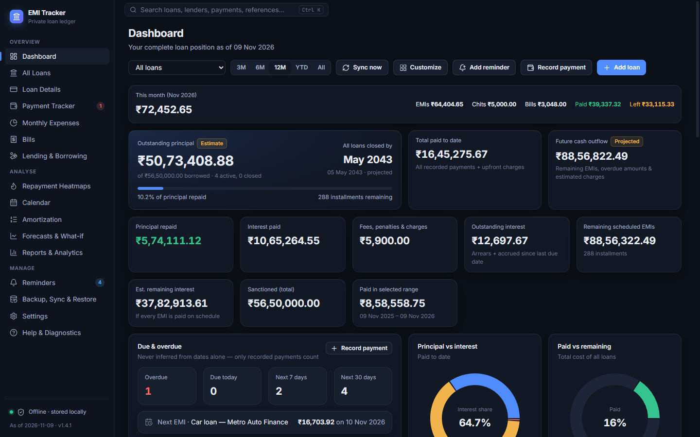
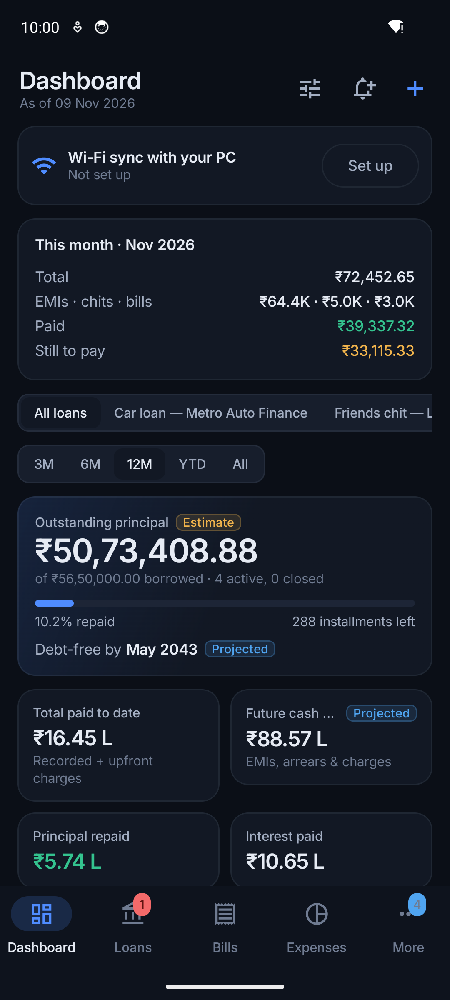
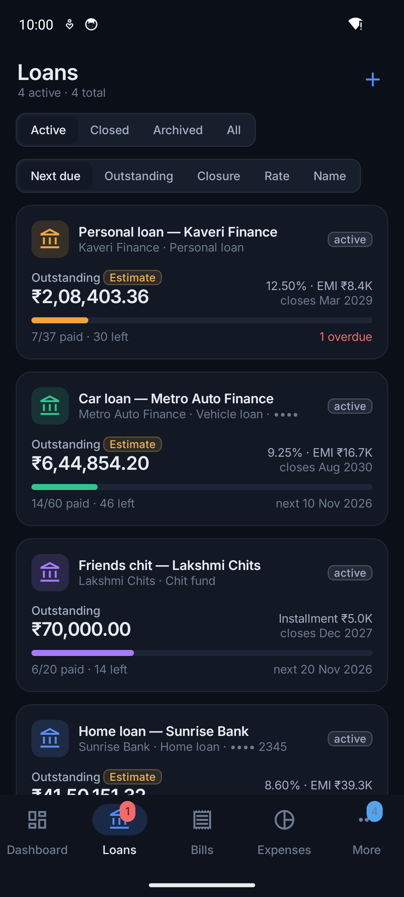
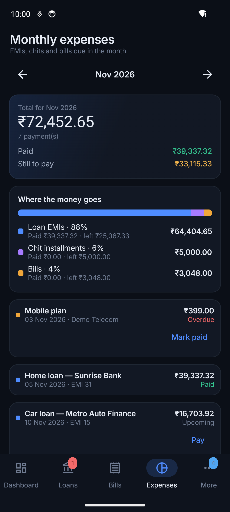
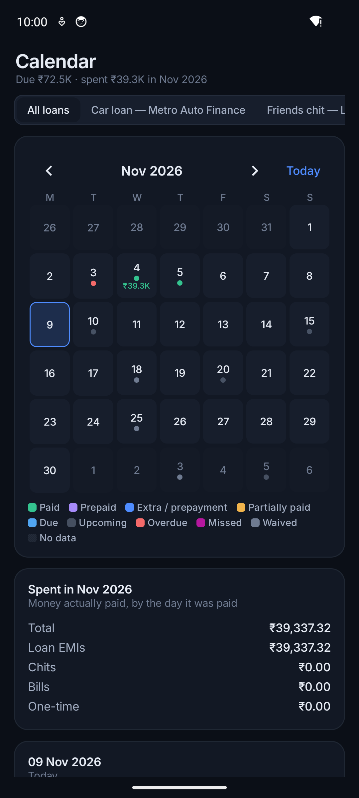
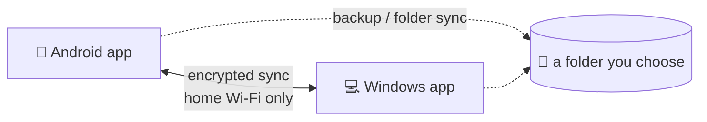
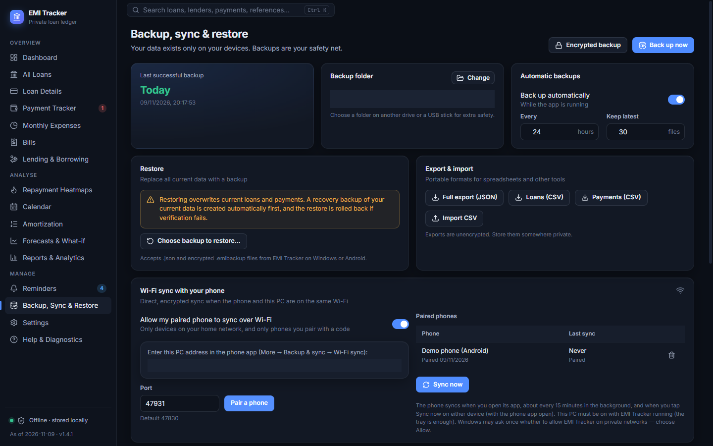
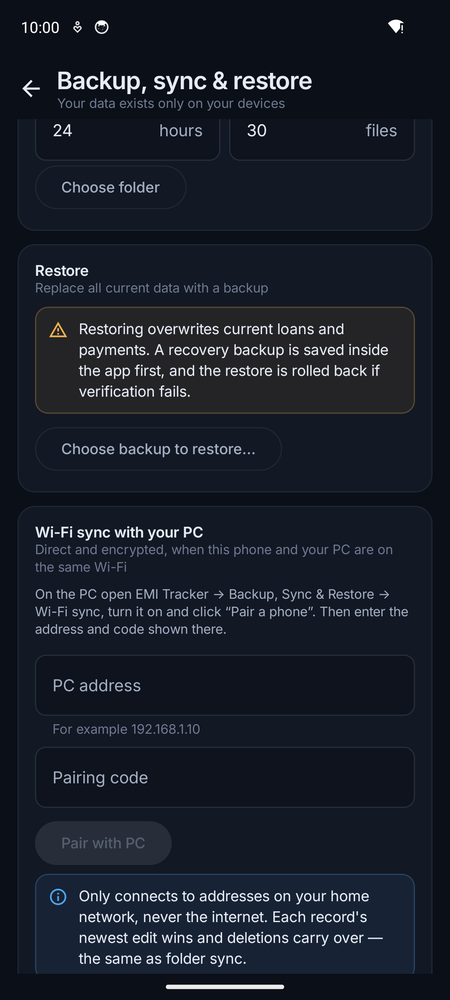

# EMI Tracker

**A private, offline app for Windows and Android that keeps track of your loans, EMIs, chit funds,
bills and money lent or borrowed, and reminds you before anything is due.**

Your data stays on your own phone and PC: no accounts, no cloud, no ads, no tracking. The two apps can
sync with each other directly over your home Wi-Fi.



<table>
  <tr>
    <td></td>
    <td></td>
    <td></td>
    <td></td>
  </tr>
</table>

<sub>All screenshots are of the real apps using fictional [demo data](docs/DEMO_DATA.md).</sub>

## Why EMI Tracker?

Most people with a home loan, a car loan and a few monthly bills juggle bank apps, SMS alerts and
spreadsheets, and still can't easily answer: *How much do I pay this month? When will I be debt-free?
What did that prepayment actually save?* Online "money manager" apps answer this by asking for your
financial data.

EMI Tracker answers it **without your data ever leaving your devices**:

- one place for every EMI, chit installment and bill, with reminders;
- exact loan maths: amortization, prepayments, floating-rate changes, part and missed payments;
- clear answers: this month's total, outstanding principal, interest paid, debt-free date;
- your records under your control, with verified (optionally encrypted) backups.

## Features

| | |
| --- | --- |
| **Loans** | Any loan type, guided 7-step setup, exact or calculated EMI, floating-rate and EMI changes, prepayments, loans already in progress, lender reconciliation |
| **Chit funds** | Installments with dividends, no interest |
| **Payments** | EMI, part, advance, prepayment, foreclosure, fees; missed and waived; edit or reverse with a full audit trail |
| **Bills & one-time expenses** | Rent, electricity, mobile, insurance… every 1–12 months, or once |
| **Monthly expenses & calendar** | Everything due this month, what is paid and left; a calendar of dues and of what you spent each day |
| **Lending & borrowing** | Money lent to or borrowed from people, with part repayments and reminders |
| **Dashboard & analysis** | Debt-free date, interest paid, charts, repayment heatmaps, what-if forecasts |
| **Reminders** | Before, on and after due dates, for loans, bills, lending, and your own reminders |
| **Reports** | CSV, PDF and print, including Indian financial-year totals |
| **Backup & sync** | Verified backups (AES-256 encryption optional), automatic backups, restore across platforms, Wi-Fi and folder sync |
| **App lock** | PIN, password, Windows Hello, fingerprint / face |

Full list with examples: **[docs/FEATURES.md](docs/FEATURES.md)**.

## Android and Windows, together

| | Windows | Android |
| --- | --- | --- |
| Requires | Windows 10 / 11 (64-bit) | Android 8.0 or newer |
| Current version | 1.4.1 | 1.4.2 |
| Data stored in | `%APPDATA%\EMI Tracker` | App-private storage |

Each app works on its own. Using both, pair the phone with the PC once with a 6-digit code; after that
they exchange changes directly over your home Wi-Fi, encrypted, with no internet involved:



How it works, step by step: **[docs/SYNC_GUIDE.md](docs/SYNC_GUIDE.md)**.

<table>
  <tr>
    <td></td>
    <td></td>
  </tr>
</table>

## Installation

> No ready-made installers or APKs have been published yet. Build them from source; it takes a few
> commands. Full instructions, permissions and first steps: **[docs/INSTALLATION.md](docs/INSTALLATION.md)**.

```bash
git clone https://github.com/svrsunny/emi-tracker.git
cd emi-tracker
```

**Windows** (needs Node.js 22+):

```bash
cd desktop
npm install
npm run dist
```

Then run `desktop/release/EMI Tracker-Setup-<version>.exe`.

**Android** (needs JDK 17+ and the Android SDK, e.g. via Android Studio):

```bash
cd android
./gradlew :app:assembleRelease
```

Then install `android/app/build/outputs/apk/release/app-release.apk` on your phone.

## Quick start

1. Open the app and choose **Add your first loan**, or **Explore with demo data** to look around first.
2. Enter the loan from your loan papers. Tip: choose **Enter from lender** for the EMI.
3. Record each EMI when you pay it (the app reminds you before it is due).
4. Add your monthly **Bills**; see everything due in **Monthly expenses**.
5. Turn on **automatic backups** (*Backup, Sync & Restore*).
6. Optional: pair your phone and PC for **Wi-Fi sync**, and set an **App lock**.

Step-by-step: **[docs/USER_GUIDE.md](docs/USER_GUIDE.md)**.

## Privacy and security

- **No internet use.** The Windows app blocks every outbound request; the Android app only talks to
  your own PC on your home network, and only for Wi-Fi sync.
- **No accounts, telemetry, ads, analytics or cloud.**
- **Encrypted sync** after pairing with a code; **optional encrypted backups**; optional **app lock**.
- The app lock protects the screens; the database itself is not encrypted by the app (your device's
  encryption protects it).

Read [PRIVACY.md](PRIVACY.md), [SECURITY.md](SECURITY.md) (how to report a vulnerability) and the
[security review](docs/SECURITY_AUDIT.md), including the known limitations of the Wi-Fi sync.

## Technology

| Windows app (`desktop/`) | Android app (`android/`) |
| --- | --- |
| Electron, React, TypeScript, Vite | Kotlin, Jetpack Compose (Material 3) |
| SQLite via sql.js (WebAssembly) | Room (SQLite), WorkManager |
| decimal.js, zod, Recharts | kotlinx.serialization, BiometricPrompt |
| Vitest, Playwright | JUnit, Robolectric |

The financial rules are implemented in both TypeScript and Kotlin and kept identical by shared test
fixtures; both apps read each other's backup files.

```
emi-tracker/
├── desktop/            Windows app (Electron)
├── android/            Android app (core/ = shared Kotlin logic, app/ = UI)
├── docs/               documentation
├── demo/               fictional demo backup
├── fixtures/           cross-platform test files
└── assets/screenshots/ screenshots used in the docs
```

Architecture: **[docs/TECHNICAL_ARCHITECTURE.md](docs/TECHNICAL_ARCHITECTURE.md)** · building and
testing: **[docs/DEVELOPMENT.md](docs/DEVELOPMENT.md)**.

## Documentation

| For users | For developers |
| --- | --- |
| [Features](docs/FEATURES.md) | [Development guide](docs/DEVELOPMENT.md) |
| [Installation](docs/INSTALLATION.md) | [Technical architecture](docs/TECHNICAL_ARCHITECTURE.md) |
| [User guide](docs/USER_GUIDE.md) | [Financial calculations](docs/FINANCIAL_CALCULATIONS.md) |
| [Sync guide](docs/SYNC_GUIDE.md) | [Backup format and restore](docs/BACKUP_AND_RESTORE.md) |
| [FAQ and known limitations](docs/FAQ.md) | [Reminders and notifications](docs/NOTIFICATIONS.md) |
| [Troubleshooting](docs/TROUBLESHOOTING.md) | [Testing log](docs/TESTING.md) |
| [Demo data](docs/DEMO_DATA.md) | [Versioning and releases](docs/RELEASING.md) |
| [Privacy](docs/PRIVACY.md) | [Security review](docs/SECURITY_AUDIT.md) |

## Known limitations

- No ready-made downloads yet; build from source.
- No bank or SMS import; you enter loans and payments yourself.
- Wi-Fi sync needs the Windows app running and both devices on the same home network.
- Android may delay reminders to save battery; Windows reminders need the app running (the tray is
  enough).
- English interface only; Windows and Android only.

More in the [FAQ](docs/FAQ.md#known-limitations).

## Contributing

Bug reports, ideas and pull requests are welcome. Please read [CONTRIBUTING.md](CONTRIBUTING.md) and
the [Code of Conduct](CODE_OF_CONDUCT.md). Never include real financial data in issues or pull
requests; use the [demo data](docs/DEMO_DATA.md).

## License

[MIT](LICENSE). Bundled fonts and libraries keep their own licenses; see
[THIRD_PARTY_NOTICES.md](THIRD_PARTY_NOTICES.md).
