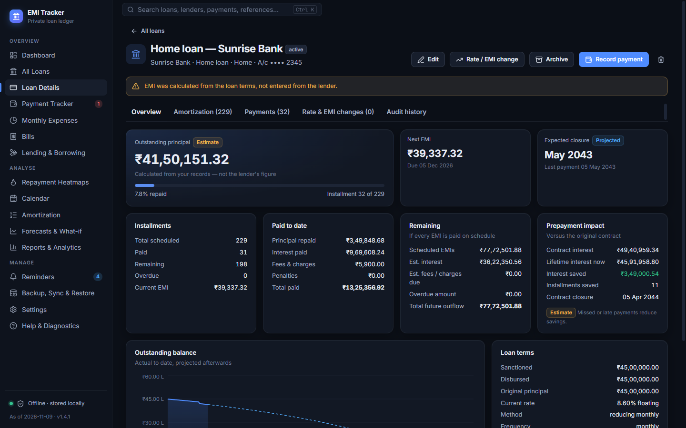
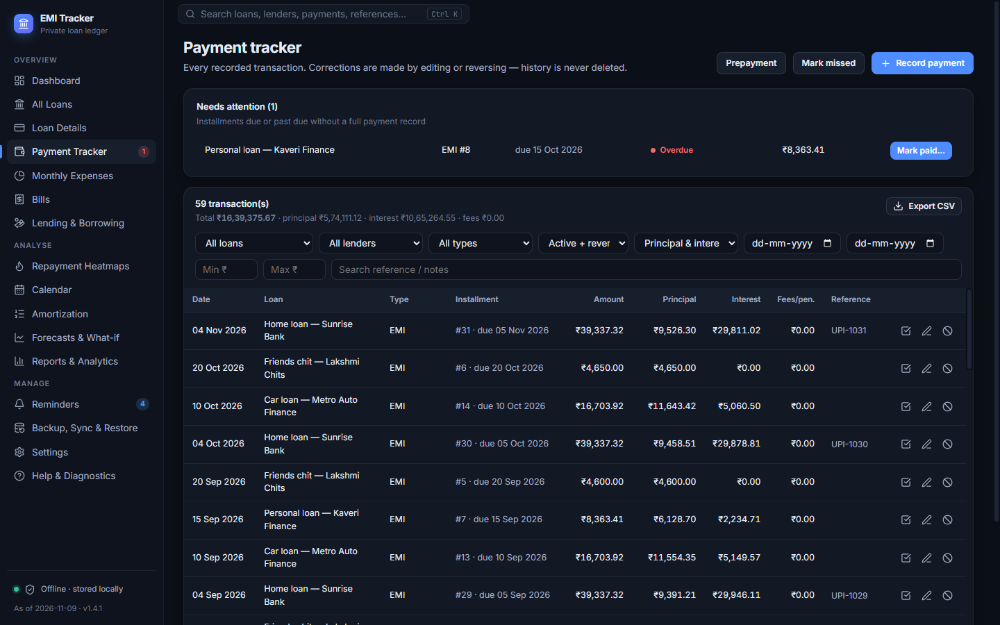
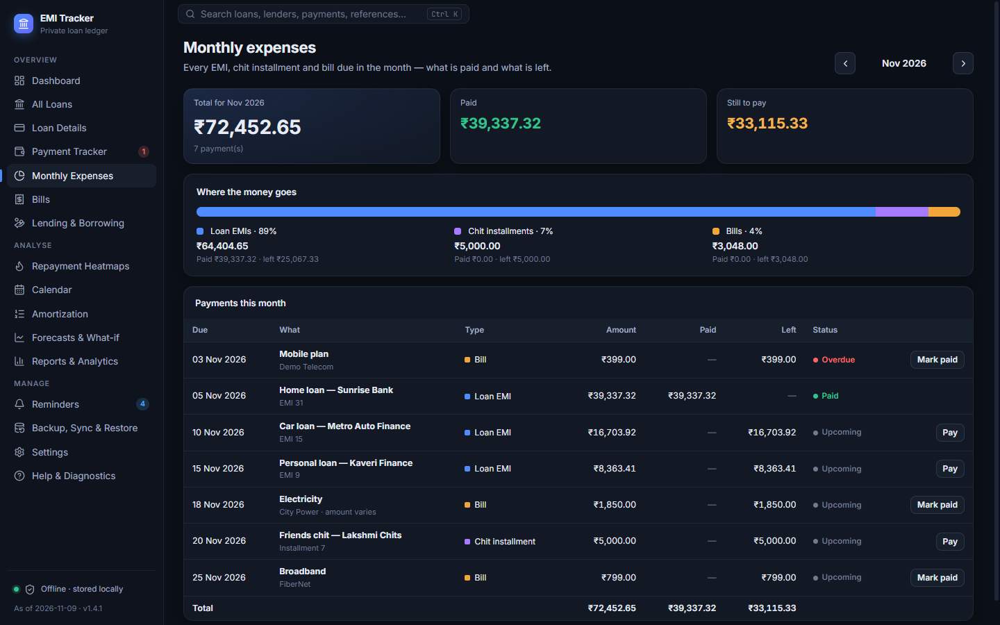
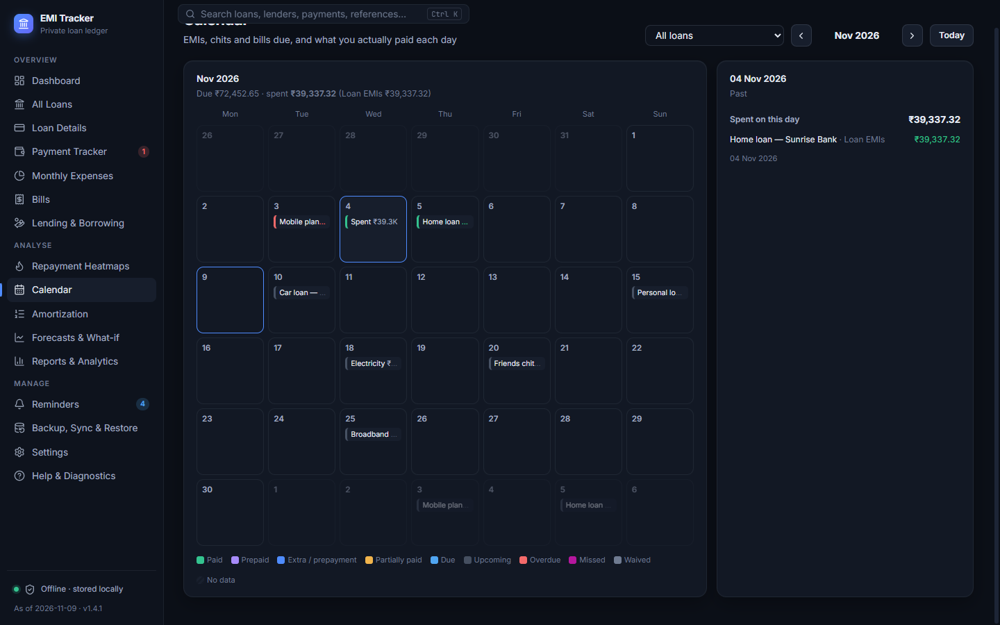
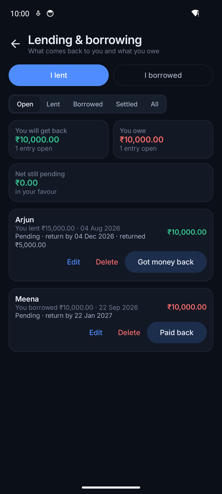
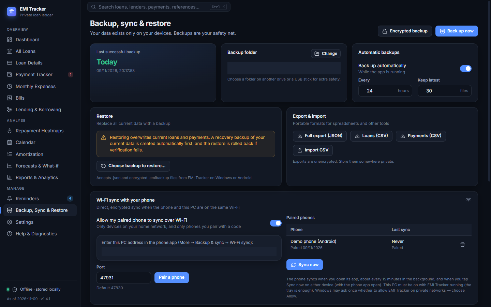

# Features

Everything below is available in **both** the Windows and the Android app unless marked otherwise.
Screenshots use the fictional [demo data](DEMO_DATA.md).

- [Loans](#loans) · [Chit funds](#chit-funds) · [Payments](#payments)
- [Bills and one-time expenses](#bills-and-one-time-expenses) · [Monthly expenses](#monthly-expenses) · [Calendar](#calendar)
- [Lending and borrowing](#lending-and-borrowing) · [Dashboard](#dashboard) · [Analysis](#analysis-heatmaps-forecasts-reports)
- [Reminders](#reminders) · [Backup, restore and export](#backup-restore-and-export) · [Sync](#sync-between-phone-and-pc)
- [App lock](#app-lock) · [Settings](#settings-and-search)

---

## Loans

Track any number of loans: home, personal, vehicle, education, gold, business, consumer durable,
credit card, loan against property, chit fund or other.

- **Guided "Add loan" wizard** in 7 steps: *Basics → Amount & rate → Schedule → Charges & rules →
  History → Reminders → Review*. The EMI is calculated live, or you type the exact EMI from your
  lender.
- **Everything a real loan has:** sanctioned, disbursed and principal amounts; fixed or floating
  rate; reducing-balance (monthly or daily) or flat interest; monthly or other repayment frequencies;
  moratorium (interest added to principal, or pay interest only); processing and other fees; late fee,
  penal interest and grace period; advance EMI balance with the lender.
- **Loans that started before you began tracking:** say how many EMIs were already paid and the
  outstanding balance from your statement. The app continues from there and labels old figures as
  estimates.
- **Rate and EMI changes** with an effective date (for example a floating-rate revision), and
  restructuring.
- **Lender reconciliation:** enter the outstanding amount from your lender's statement and see the
  difference from the app's figure.
- **Loan details page:** outstanding principal, next EMI, expected closure date, installments paid and
  remaining, what you have paid so far (principal, interest, fees), and the effect of prepayments.
- Archive, close or reactivate loans; delete permanently (a recovery backup is taken first).

*Example:* a ₹45,00,000 home loan at 8.6% for 20 years shows an EMI of about ₹39,337. After a
₹1,00,000 prepayment the details page shows how many installments and how much interest it saved.

## Chit funds

Choose *Chit fund* as the loan type and enter only the chit value, the monthly installment, the number
of months and the first installment date: there is no interest. Record what you actually paid each
month; anything below the full installment is counted as your **dividend**. See
[FINANCIAL_CALCULATIONS.md](FINANCIAL_CALCULATIONS.md#chit-funds).

## Payments

- Record an **EMI, part payment, advance, prepayment, foreclosure, fee or penalty**, or mark an
  installment **missed** or **waived**.
- The payment date is kept separate from the due date, so late and early payments are visible.
- Add a reference (for example a UPI reference) and notes. On Windows you can also attach a receipt
  file.
- **Nothing is ever silently deleted:** payments are edited or **reversed with a reason**, and every
  change goes into an audit trail. Possible duplicates are flagged before saving.
- **Payment tracker / history** with filters by loan, lender, type, date, status and amount, and CSV
  export.

## Bills and one-time expenses

- **Recurring bills** (rent, electricity, water, gas, mobile, internet, TV, insurance, subscriptions,
  school fees, maintenance, credit card, other) every 1, 2, 3, 6 or 12 months, with a due day and
  optional last due date. For bills whose amount changes (electricity), the actual amount is entered
  when you pay.
- **One-time expenses** (*Repeats → Only once*): what for, amount and date. If the date is today or
  earlier it can be saved as already paid.
- Reminders before the due date, on the day, and the day after if still unpaid.
- Payment history per bill, with undo.

## Monthly expenses

Every EMI, chit installment and bill due in a month in one list, with the amount, what is paid, what is
left and the status of each, plus **"Where the money goes"** (share of loan EMIs, chits and bills).
Move month by month.

## Calendar

A month grid showing what is due on each day (EMIs, chit installments, bills and one-time expenses,
coloured by status) and **how much you actually spent each day**. Selecting a day lists what was due
(with *Record payment* / *Mark paid*) and what was paid. The month's spending is split into loan EMIs,
chits, bills and one-time expenses.

## Lending and borrowing

Money you lent to or borrowed from friends and family, without interest: who, how much, when, an
optional return-by date (with reminders), and part repayments with undo. The totals at the top follow
the filter: *Open* (you will get back / you owe / net), *Lent*, *Borrowed*, *Settled* (total settled)
and *All*. Lending is **not** counted as an expense.

## Dashboard

- **This month:** total due, split into EMIs, chits and bills, with paid and still to pay.
- Outstanding principal, debt-free date, principal repaid, interest paid, fees, total paid, future
  cash outflow, remaining EMIs and more.
- **Due and overdue:** overdue count, due today, next 7 and 30 days, next EMI.
- Charts: principal vs interest, paid vs remaining, loan-wise progress, monthly payment history,
  actual vs scheduled, interest over time, loan closure timeline, yearly distribution and a heatmap.
- Filters by loan and date range (3M, 6M, 12M, YTD, All); widgets can be hidden and reordered.
- *Sync now* button for Wi-Fi sync.

## Analysis: heatmaps, forecasts, reports

- **Repayment heatmaps:** daily, weekly, monthly and yearly views of what you paid (amount, principal,
  interest, count, missed or overdue), loan comparison and scheduled-vs-actual. "No data" is shown
  differently from "zero".
- **Amortization schedules** for each loan: actual payments to date, projection afterwards.
- **Forecasts and what-if:** compare up to four scenarios (higher EMI, extra monthly payment, one-time
  or yearly prepayment, new rate) and see the new closure date, months saved and interest saved.
- **Reports:** loan summary, payment ledger, amortization, annual totals, interest paid, principal
  repaid, missed and late payments, closures, prepayment savings and Indian financial-year totals.
  Export as **CSV** or a clean A4 **PDF**, or print.

## Reminders

- **EMI reminders:** before the due date (choose the days), on the due day, when overdue (repeating
  up to a limit) and when missed; upcoming loan closures; monthly and weekly summaries; backup and
  rate-change reminders.
- **Bill and lending reminders** as described above.
- **Your own reminders** that need no loan: title, note, date, time, repeating once, daily, weekly,
  monthly or yearly.
- Reminder time, quiet hours, weekdays, snooze, catch-up of missed reminders, an inbox and history.
  Details in [NOTIFICATIONS.md](NOTIFICATIONS.md).

## Backup, restore and export

- **Backups** you save anywhere (a folder, SD card, USB drive, or a cloud-synced folder of your
  choice). Every backup is verified by reading it back.
- **Encrypted backups** with a passphrase (AES-256-GCM). The passphrase is never stored.
- **Automatic backups** into a folder you choose, keeping the latest N files.
- **Restore** with a preview and validation; a recovery copy of your current data is saved first, and
  the restore is rolled back if anything fails. A backup from Windows restores on Android and vice
  versa.
- **Export** everything as JSON, and loans or payments as CSV for spreadsheets. On Windows you can also
  import loans and payments from CSV.

Details in [BACKUP_AND_RESTORE.md](BACKUP_AND_RESTORE.md).

## Sync between phone and PC

- **Wi-Fi sync:** pair the phone with the PC once using a 6-digit code; after that they exchange
  changes directly over your home Wi-Fi, encrypted. No internet or cloud is involved.
- **Folder sync:** both apps read and write a sync file in a folder you choose (useful with a USB
  cable, SD card or your own folder-sync tool).
- Changes merge record by record: the newest edit of each record wins, and deletions carry over.

See the [Sync guide](SYNC_GUIDE.md).

## App lock

Optional, set separately on each device: an app PIN or password, **Windows Hello** (fingerprint, face
or Windows PIN) on Windows, or the phone's **screen lock / fingerprint / face** on Android. Locks when the
app starts and after it has been away for the time you choose (on Windows also when the PC locks or
sleeps). Wrong guesses are throttled. On Android the app's content is hidden from the recent-apps
screen and screenshots while the lock is on.

## Settings and search

- Currency (₹ by default), Indian (₹12,34,567) or international grouping, decimals, date format, week
  start, time zone, dark / light / system theme and accent colour.
- Dashboard widgets, heatmap colours and thresholds, default filters and sorting.
- **Windows only:** keep running in the system tray, start with Windows, global search (Ctrl+K)
  across loans, lenders, notes, payments and references, and receipt attachments.
- *Help & Diagnostics:* a short guide, app version, storage information and (Windows) the count of
  blocked network requests, which should always be zero.
