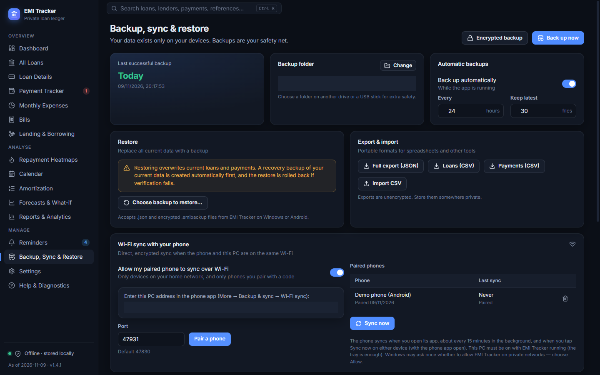
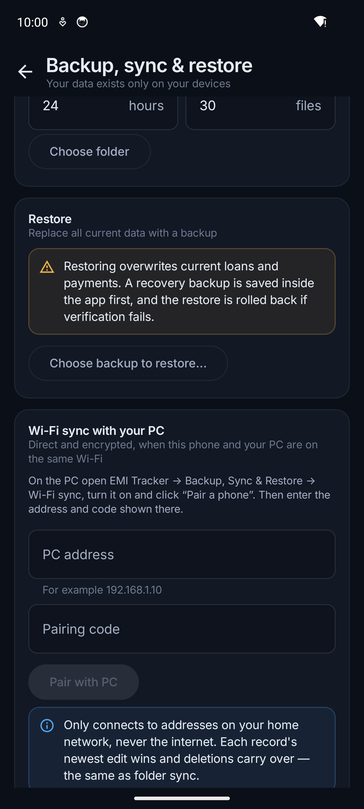
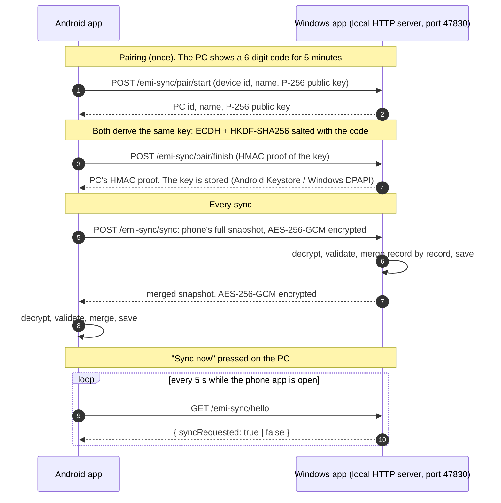
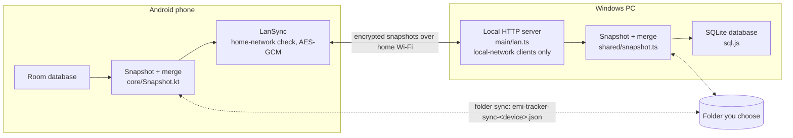

# Sync guide: Android ⇄ Windows

EMI Tracker can keep your phone and your PC up to date with each other **without any internet or
cloud service**. There are three ways, and you can combine them:

| Way | Needs | Best for |
| --- | --- | --- |
| **Wi-Fi sync** | Phone and PC on the same home Wi-Fi; the PC app running | Everyday use |
| **Folder sync** | A folder both devices can reach (USB cable, SD card, or a folder you mirror yourself) | No shared Wi-Fi |
| **Backup and restore** | Moving one backup file | A one-time copy, or moving to a new phone |

## Wi-Fi sync

### Before you start

- Both apps on the **same version** if possible (an older app may not read newer data).
- Phone and PC on the **same home network**. Guest networks and "AP isolation" usually stop devices
  from seeing each other.
- A fixed local address for the PC helps: set a *static IP* or *DHCP reservation* for the PC in your
  router, so the address you enter on the phone keeps working.

### Pair the phone with the PC (once)

**On the PC**

1. Open **Backup, Sync & Restore** and find **Wi-Fi sync with your phone**.
2. Turn on **Allow my paired phone to sync over Wi-Fi**. If Windows asks whether to allow EMI Tracker
   on networks, allow it on **private networks**.
3. Note the PC address shown (for example `192.168.1.50`; if you changed the port it is shown as
   `192.168.1.50:47900`).
4. Click **Pair a phone**. A **6-digit code** appears, valid for 5 minutes.

**On the phone**

5. Open **More → Backup, sync & restore → Wi-Fi sync with your PC**.
6. Enter the **PC address** and the **pairing code**, then tap **Pair with PC**.
7. Both apps confirm the pairing and the first sync runs immediately.

### When it syncs

- When you open the app on the phone, shortly after you change something, and about **every 15
  minutes** in the background while the phone is on the same Wi-Fi (Android may delay background
  work to save battery).
- When you tap **Sync now** on the phone (dashboard or sync settings).
- When you click **Sync now** on the PC: the PC cannot contact the phone by itself, so it raises a
  "please sync" flag. The phone checks for it every few seconds **while EMI Tracker is open on the
  phone**, and syncs. The PC button shows *Waiting for phone…* until then (the request stays open
  for 10 minutes).

The PC must be on with EMI Tracker running. Keeping it in the system tray is enough.

### Unpairing

- Phone: **Unpair** in the Wi-Fi sync card.
- PC: the bin icon next to the phone under **Paired phones**.

Either one revokes the shared key; pair again to resume.

## How it works

- The **PC is the server** and only answers; the **phone always starts** the exchange. The PC refuses
  connections from outside the local network, and the phone refuses to connect to anything that is not
  a home-network address.
- Each sync sends the **whole data set** (it is small), not just changes. Both apps use the same
  snapshot format as backups, with a checksum.

### What is synced

| Synced | Not synced (stays on each device) |
| --- | --- |
| Loans, payments, rate/EMI changes, bills and bill payments, lending entries and repayments, your reminders, notification history, categories, the audit trail, preferences (currency, theme, reminder settings…) | App lock settings, Wi-Fi pairing keys, backup and sync folders, the device name, attachments (Windows receipts) |

### Conflicts and deletions

- Changes merge **record by record**: if the same loan or payment was edited on both devices, the
  **newest edit wins** (by its last-changed time). Edits to *different* records never conflict.
- **Deletions carry over:** a deleted record leaves a small deletion marker ("tombstone"), so it is
  deleted on the other device too instead of coming back.
- **Erase all data** clears the deletion markers too. After erasing on one device, the other device's
  records come back on the next sync. To start fresh everywhere, erase on both devices before
  syncing, or unpair first.
- Payments, bill payments and repayments whose parent record was deleted are dropped.
- Device clocks matter for "newest wins": keep automatic date and time turned on.

### Security

- Pairing uses an **ECDH (P-256) key agreement** bound to the 6-digit code; each side proves it holds
  the same key before the pairing is saved. The PC accepts at most 5 wrong codes per pairing window.
- Every snapshot is **encrypted and authenticated with AES-256-GCM** using that key, bound to the device
  and the direction.
- The messages travel over **plain HTTP inside your network**: the content is encrypted, but someone
  on your Wi-Fi can see that two devices are talking, the port, device ids and the unencrypted
  `/emi-sync/hello` reply.
- Pair on a network you trust. See the known limitations in
  [SECURITY_AUDIT.md](SECURITY_AUDIT.md#known-limitations).

## Folder sync

1. On **both** devices: **Backup, Sync & Restore → Folder sync → Choose folder** (Android: **More →
   Backup, sync & restore → Folder sync → Choose folder**), and pick a folder that both can reach.
2. Optional: **Encrypt sync files** with the **same passphrase** on every device.
3. Use **Sync now**, or turn on **Automatic sync**.

Each device writes `emi-tracker-sync-<device-id>.json` into the folder and merges the files written by
the others, with the same newest-wins and deletion rules as Wi-Fi sync. You move or mirror the files
yourself (USB cable, SD card, or a sync tool of your choice); the app itself never uploads anything.

## Troubleshooting

| Problem | What to try |
| --- | --- |
| "PC not reachable" | Is the PC on, with EMI Tracker running and **Allow my paired phone to sync over Wi-Fi** turned on? Are both on the same Wi-Fi (not a guest network)? Did the PC's address change? Check it on the PC and use **Pair again** on the phone |
| Windows never asked about the firewall, and the phone cannot connect | In *Windows Security → Firewall & network protection → Allow an app through firewall*, allow **EMI Tracker** on **Private** networks. Make sure your Wi-Fi is set as a *private* network in Windows |
| "Wrong pairing code" / "Pairing expired" | Click **Pair a phone** again on the PC and use the new code within 5 minutes |
| "This phone is not paired with this PC" / "Pairing key mismatch" | The pairing was removed on one side. Use **Pair again** on the phone |
| "is not a home-network address" | Enter the PC's local address (it usually starts with `192.168.`, `10.` or `172.16`–`172.31`), not a public address or website |
| Port already in use | Change the **Port** on the PC (for example `47900`) and enter the address as `192.168.1.50:47900` on the phone |
| Sync works, but something I deleted came back | It was probably erased with *Erase all data* on one device only (see [Conflicts and deletions](#conflicts-and-deletions)), or the device clocks were wrong |
| Sync fails after updating only one device | Update both apps to the same version |
| PC *Sync now* says "Waiting for phone…" | Open EMI Tracker on the phone; it notices the request within a few seconds |

More in [TROUBLESHOOTING.md](TROUBLESHOOTING.md).
