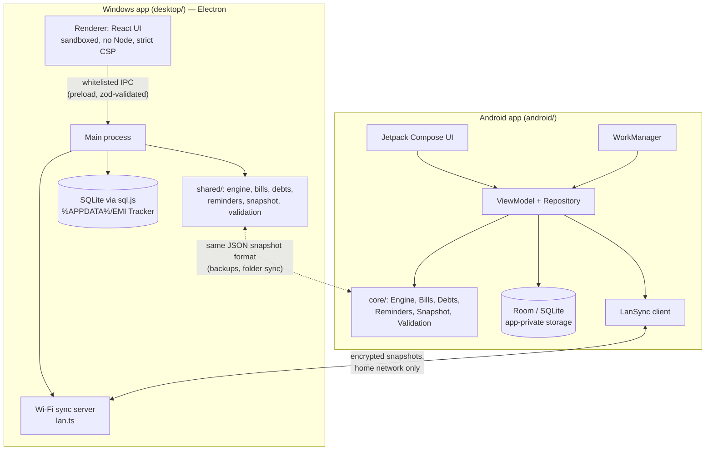

# Technical architecture

Two native apps share one design: the same domain model, the same financial rules (implemented
once in TypeScript and once in Kotlin, and cross-checked by shared test fixtures), and the same
versioned snapshot format for backup, export and sync.



## Repository layout

```
emi-tracker/
├── desktop/                       Windows app: Electron + React + TypeScript + Vite
│   ├── src/shared/                UI-independent core (used by the main process and the UI)
│   │   ├── engine.ts              amortization, payment allocation, statuses
│   │   ├── forecast.ts            what-if scenarios
│   │   ├── aggregate.ts           dashboard totals, heatmap cells, series, annual / FY summaries
│   │   ├── bills.ts               bill due dates, monthly expenses, spending by day
│   │   ├── debts.ts               lending & borrowing summaries and totals
│   │   ├── reminders.ts           reminder planner (pure)
│   │   ├── snapshot.ts            canonical JSON, normalisation, record-level merge
│   │   ├── validation.ts          zod schemas (IPC boundary, forms, restore)
│   │   └── money.ts dates.ts format.ts csv.ts print.ts defaults.ts types.ts
│   ├── src/main/                  Electron main process
│   │   ├── main.ts                window, tray, offline enforcement, background loop
│   │   ├── ipc.ts                 whitelisted, validated IPC handlers
│   │   ├── db.ts                  SQLite (sql.js) + migrations + atomic persistence
│   │   ├── repo.ts                repository: transactions, audit, duplicates, reversal, tombstones
│   │   ├── backup.ts              snapshot, AES-GCM encryption, validation, restore + rollback
│   │   ├── sync.ts                folder sync and merge
│   │   ├── lan.ts lanProtocol.ts  Wi-Fi sync server and protocol (ECDH, HKDF, AES-GCM)
│   │   ├── lock.ts                app lock (scrypt hashes, Windows Hello)
│   │   ├── pdf.ts                 PDF reports (hidden window + printToPDF)
│   │   └── scheduler.ts           reminder delivery
│   ├── src/preload/               contextBridge API (channel whitelist)
│   ├── src/renderer/              React UI: pages, components, charts, heatmaps
│   └── tests/                     unit (Vitest), e2e (Playwright on the real app),
│                                  demo (demo-data generator), screens (README screenshots)
├── android/                       Android app: Kotlin + Jetpack Compose + Room + WorkManager
│   ├── core/                      pure Kotlin/JVM module: Engine, Forecast, Aggregate, Bills,
│   │                              Debts, Reminders, Snapshot (checksum, AES-GCM, merge), Lan,
│   │                              Validation, Csv, Money, Dates
│   └── app/                       Android application
│       ├── data/                  Room entities / DAO / migrations, Repository, demo data
│       ├── io/                    BackupService (SAF backup / restore / folder sync), LanSync
│       ├── security/              AppLock (PBKDF2 hashes, BiometricPrompt)
│       ├── work/                  WorkManager worker, notifications, background sync
│       └── ui/                    Compose design system, screens, charts, heatmaps, PDF / print
├── fixtures/                      cross-platform test files (each app reads the other's)
├── demo/                          fictional demo backup (see docs/DEMO_DATA.md)
├── assets/screenshots/            README screenshots taken with the demo data
└── docs/
```

## Layers and ownership

| Concern | Owner | Notes |
| --- | --- | --- |
| Financial maths | `engine.ts` / `Engine.kt` | Pure: inputs are records and an "as of" date; outputs are schedule rows, per-payment allocations and a summary |
| Bills, expenses, spending, lending | `bills.ts`, `debts.ts` / `Bills.kt`, `Debts.kt` | Pure functions shared by the UI and the reminder planner |
| Portfolio figures | `aggregate.ts` / `Aggregate.kt` | Only sum engine output and records; nothing hard-coded |
| Persistence and integrity | `repo.ts` / `Repository.kt` | One transaction per change, audit entries, validation, duplicate detection, reversal, tombstones |
| Trust boundary | `ipc.ts` + zod (Windows) | Every IPC payload is validated; the sender must be the app's own page; while locked only lock channels are served |
| Backup / restore / sync | `backup.ts`, `sync.ts`, `lan.ts` / `BackupService.kt`, `LanSync.kt`, `Snapshot.kt` | Same format, same checksum, same merge |
| Background work | Electron main loop (1-minute tick and on resume) / WorkManager | Reminders, automatic backup, automatic sync |
| UI | React / Compose | Recompute engine output from records whenever they change |

## Data model

Every synced record has `id` (UUID), `createdAt` and `updatedAt`.

| Table | Contents |
| --- | --- |
| `loans` | Loan terms (also chit funds, `loanType: "chit_fund"`) |
| `adjustments` | Rate, EMI and restructuring changes with effective dates |
| `payments` | EMIs, part payments, prepayments, fees, missed / waiver markers; reversed payments are kept |
| `bills`, `bill_payments` | Recurring bills and one-time expenses (`frequency: "once"`), one payment per due date |
| `debts`, `debt_repayments` | Lending & borrowing entries and their repayments |
| `custom_reminders`, `notifications` | Your own reminders; delivered-notification history |
| `audit`, `categories` | Change history; loan categories |
| `tombstones` | Deletion markers that make deletions sync |
| `kv` | Preferences (synced) and device-local settings (not synced: app lock, pairing keys, folders) |
| `backup_history` | Verified backups made on this device |

Storage keeps a few indexed columns plus the full JSON document of each record. SQLite foreign keys
(`ON DELETE RESTRICT`) keep children attached to existing parents; updates use true upserts
(`ON CONFLICT DO UPDATE` / Room `@Upsert`), never delete-and-reinsert.

### Schema versions and migrations

| Version | Change |
| --- | --- |
| 1 | Core tables |
| 2 | `tombstones`, `backup_history` (sync support) |
| 3 | `bills`, `bill_payments` |
| 4 | `debts`, `debt_repayments` |

Windows (`db.ts`) copies the database file before migrating; Android uses Room migrations
(`MIGRATION_1_2` … `MIGRATION_3_4`) checked against the exported Room schemas in
`android/app/schemas/`. Both are tested by migrating a real version-1 database. Backups written before
a table existed still restore (missing tables are treated as empty and do not change the checksum).

## Snapshot format (backups, exports, sync)

A snapshot is JSON: `format`, `formatVersion`, `schemaVersion`, `kind` (backup / sync / export /
recovery), creating app and device, record counts, a SHA-256 checksum over the canonical data, and the
data itself. Encrypted files wrap it in AES-256-GCM with a PBKDF2-HMAC-SHA256 key (210,000
iterations). Details: [BACKUP_AND_RESTORE.md](BACKUP_AND_RESTORE.md).

Merging (folder sync and Wi-Fi sync) is record by record: the newer `updatedAt` wins (ties are broken
deterministically), tombstones remove records on the other side, and orphaned children are dropped.

## Wi-Fi sync

The Windows app runs a small HTTP server (default port 47830) that answers only clients on the local
network. The Android app pairs with it using ECDH P-256 + HKDF-SHA256 bound to a 6-digit code and
exchanges AES-256-GCM-encrypted snapshots. Protocol, data flow and limitations:
[SYNC_GUIDE.md](SYNC_GUIDE.md#how-it-works).

## App lock

- Windows (`lock.ts`): PIN / password stored as a salted scrypt hash; Windows Hello via the WinRT
  `UserConsentVerifier`, attached to the app window. While locked, the IPC layer refuses every data
  channel.
- Android (`AppLock.kt`): PIN / password stored as a salted PBKDF2-HMAC-SHA256 hash; `BiometricPrompt`
  for fingerprint / face / the phone's screen lock; `FLAG_SECURE` while the lock is on.
- Both throttle wrong attempts (5 tries, then 30 s doubling up to 15 min).

## Why these stacks

- **Windows: Electron + React + TypeScript + Vite.** **sql.js** (SQLite compiled to WebAssembly)
  instead of a native SQLite module: there is nothing to rebuild per Electron version or CPU
  architecture, and the same engine runs in the app, in unit tests and in the packaged build. The
  database is written after each committed transaction with write-temp + fsync + atomic rename.
  Personal-loan data is small, so whole-file persistence is fast.
- **No CSS framework.** A small token-based design system (`styles.css`). Charts use Recharts, icons
  lucide; fonts are bundled.
- **Android: Kotlin, Jetpack Compose (Material 3 with a custom palette), Room, WorkManager, the Storage
  Access Framework and kotlinx.serialization.** Charts and heatmaps are custom Compose / Canvas code.
- **minSdk 26** (Android 8.0: `java.time`, notification channels, adaptive icons); target and compile
  SDK 36.
- **Money is decimal everywhere** (decimal.js / `BigDecimal`), never floating point.

## Security model (Windows)

Context isolation, no Node in the renderer, a sandboxed renderer, a strict CSP
(`connect-src 'none'`), no remote content, all outbound requests blocked and counted, permission
requests denied, navigation and new windows prevented, and a validated IPC whitelist. See
[PRIVACY.md](PRIVACY.md).
