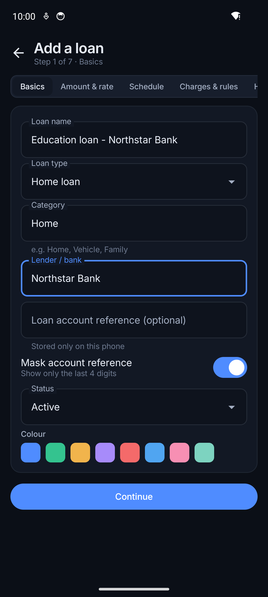
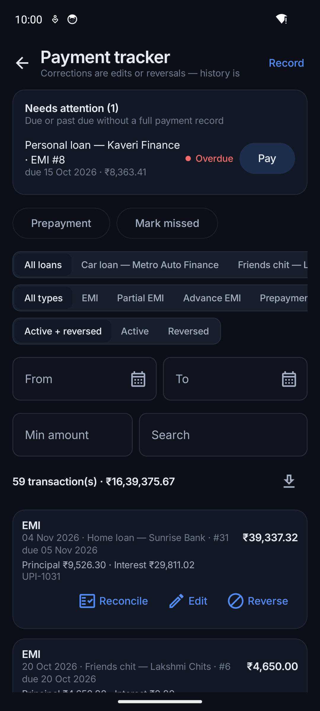
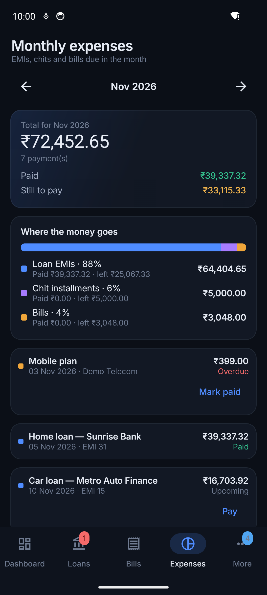

# User guide

A step-by-step guide to everyday use. Menu names are written like **this**. Where the two apps
differ, the Windows path comes first and the Android path second.

| | Windows | Android |
| --- | --- | --- |
| Main screens | Left menu: Dashboard, All Loans, Loan Details, Payment Tracker, Monthly Expenses, Bills, Lending & Borrowing, Calendar, … | Bottom tabs: **Dashboard**, **Loans**, **Bills**, **Expenses**, **More** (everything else) |

Contents: [1. Add a loan](#1-add-a-loan) · [2. Record payments](#2-record-payments) ·
[3. Bills and one-time expenses](#3-bills-and-one-time-expenses) · [4. See what you owe](#4-see-what-you-owe-each-month) ·
[5. Lending and borrowing](#5-lending-and-borrowing) · [6. Reminders](#6-reminders) ·
[7. Rate changes and prepayments](#7-rate-changes-and-prepayments) · [8. Back up](#8-back-up-your-data) ·
[9. Sync](#9-sync-your-phone-and-pc) · [10. App lock](#10-protect-the-app-with-a-lock) · [11. Reports](#11-reports-and-exports)

---

## 1. Add a loan

1. **Windows:** **All Loans → Add loan**. **Android:** **Loans → +**.
2. **Basics:** a name you will recognise (e.g. *Home loan — Sunrise Bank*), loan type, lender, and
   optionally the account number (only the last 4 digits are shown if *Mask account reference* is on).
3. **Amount & rate:** the principal, the yearly interest rate and how interest is charged (*Reducing
   balance — monthly rest* fits most Indian bank loans). For the EMI choose **Enter from lender** and
   type the exact EMI from your loan papers, or **Calculate** to let the app work it out.
4. **Schedule:** start (disbursement) date, first EMI date, EMI due day and number of EMIs.
5. **Charges & rules:** processing fee, late fee, penal interest, and what happens when you prepay
   (*Keep EMI, reduce tenure* or *Keep tenure, reduce EMI*).
6. **History:** if the loan started before you began using the app, enter how many EMIs are already
   paid and, ideally, the **outstanding principal** from your latest statement. The app continues
   from that balance.
7. **Reminders:** choose whether and how many days before each EMI to remind you.
8. **Review** and save.

> **Chit fund:** choose loan type *Chit fund*. The wizard asks only for the chit value, the monthly
> installment, the number of months and the first installment date.

## 2. Record payments

- **Windows:** **Payment Tracker → Record payment**, or the **Record payment** button on a loan, the
  dashboard or a calendar day. **Android:** the **Pay** button next to a due EMI, or **More → Payment
  history → Record**.
- Pick the type: **EMI**, part payment, advance, **prepayment**, foreclosure, fee or penalty. Enter the
  date you actually paid and the amount. Add a reference (e.g. UPI reference) if you like.
- Made a mistake? Open the payment and **Edit** or **Reverse** it (with a reason). Payments are never
  silently deleted, so your history stays trustworthy.
- If you skipped an EMI on purpose, use **Mark missed**, so it is not shown as just "unrecorded".

## 3. Bills and one-time expenses

1. Open **Bills** and choose **Add bill**: name, category, amount (tick *The amount changes every
   time* for electricity and similar), how often it repeats, the first due date and optionally a last
   due date. Choose reminder days.
2. When you pay, tap **Mark paid** and enter the actual amount.
3. For something you pay only once, choose **One-time expense** (or *Repeats → Only once*). If it is
   already paid, keep **Already paid** ticked.

Insurance premiums paid in monthly installments directly to the insurer are best added as a
**bill** with a last due date. If an insurance premium is financed by a loan with interest, add it as
a **loan**.

## 4. See what you owe each month

- **Dashboard → This month:** the month's total, split into EMIs, chits and bills, with what is paid
  and still to pay.
- **Monthly Expenses** (Android: **Expenses** tab): every item due in the month with its status, and
  *Where the money goes*. Use the arrows to move between months.
- **Calendar** (Android: **More → Calendar (EMIs & bills)**): what is due on each day and how much you
  actually spent each day. Tap a day for details.

## 5. Lending and borrowing

**Windows:** **Lending & Borrowing**. **Android:** **More → Lending & borrowing**.

1. Choose **I lent** or **I borrowed**, enter the person, amount, date and (optionally) a return-by
   date with a reminder.
2. When money comes back (or you repay), choose **Got money back** / **Paid back** and enter the amount;
   part payments are fine.
3. Use the filters (*Open, Lent, Borrowed, Settled, All*); the totals at the top always describe what
   is listed.

## 6. Reminders

- Loan, bill and lending reminders are set where you create them.
- **Your own reminders** (no loan needed): **Reminders → Add reminder** (Windows) or **More → Reminders
  & notifications** (Android). Choose a title, date, time and repeat.
- **Reminders → Settings:** reminder time, quiet hours, which kinds of reminders you want, and more.
- **Windows:** reminders appear while the app runs, including in the system tray. **Android:**
  allow notifications and set battery usage to *Unrestricted* for punctual reminders. Missed
  reminders are delivered late (and marked so), never dropped.

## 7. Rate changes and prepayments

- **Floating-rate change:** open the loan → **Rate / EMI change** (Windows) or the change button on the
  loan (Android), enter the new rate and the date it applies from, and whether your lender kept the EMI
  (longer tenure) or changed it.
- **Prepayment:** record a payment of type **Prepayment**. The loan page then shows installments and
  interest saved.
- **What if…?** **Forecasts & What-if** (Android: **More → What-if calculator**) compares up to four
  plans (higher EMI, extra monthly amount, one-time or yearly prepayment, new rate) without changing
  your data.

## 8. Back up your data

Your data lives only on your device, so backups are important.

1. **Windows:** **Backup, Sync & Restore**. **Android:** **More → Backup, sync & restore**.
2. **Back up now** saves a verified backup file where you choose. **Encrypted backup** asks for a
   passphrase first; **without that passphrase the backup cannot be restored**, so keep it safe.
3. Turn on **Automatic backups**, choose a folder and how often.
4. To restore: **Choose backup to restore…**, check the preview, then confirm by typing *RESTORE*.
   Your current data is replaced, but a recovery copy is saved first.

A backup from Windows can be restored on Android and the other way round. See
[BACKUP_AND_RESTORE.md](BACKUP_AND_RESTORE.md).

## 9. Sync your phone and PC

Pair once with a 6-digit code, then the phone and PC keep each other up to date over your home Wi-Fi.
Step-by-step instructions, how it works and troubleshooting are in the [Sync guide](SYNC_GUIDE.md).

## 10. Protect the app with a lock

**Settings → App lock** on each device:

- **Windows:** app PIN, app password, or **Windows Hello** (fingerprint, face or Windows PIN).
- **Android:** the phone's own screen lock with fingerprint / face, or an app PIN / password
  (optionally also unlocking with fingerprint / face).
- Choose when it locks again (as soon as you leave the app, or after 1, 5, 15 or 60 minutes).
- Forgot the app PIN? Windows Hello (Windows) or the phone's screen lock (Android) also unlocks.

## 11. Reports and exports

- **Reports & Analytics** (Android: **More → Reports**): choose a report and export **CSV**, **PDF** or
  print.
- **Backup, Sync & Restore → Export:** full JSON, loans CSV and payments CSV. Exports are not
  encrypted; keep them private.
